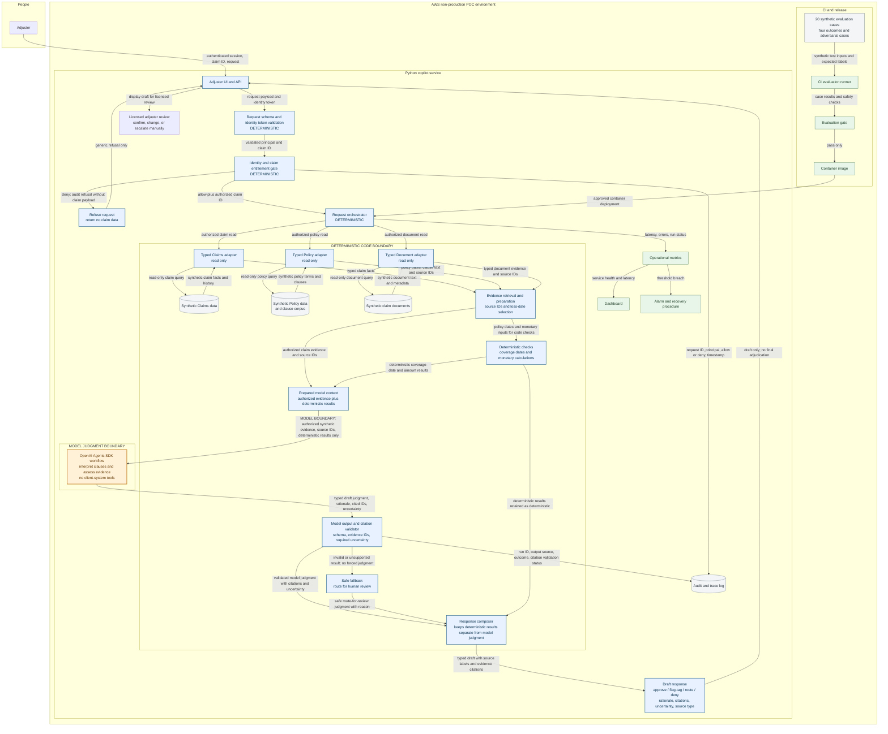

# ClaimSense AI Copilot Architecture

Runtime architecture for the five-week, synthetic-data proof of concept. Blue nodes are deterministic application code; the orange node is model judgment. The handoff between them is explicit: only authorized, prepared synthetic evidence and deterministic results cross into the model, and the model has no direct system access or authority to enforce access control.

## Boundary and flow notes

- **Deterministic code owns** identity and claim authorization, policy-date checks, monetary calculations, data retrieval, request/output schema checks, and evidence-ID validation. Authorization occurs before any agent invocation.
- **Model judgment owns** interpretation of policy language and assessment of claim evidence, including inconsistencies. It receives a prepared evidence bundle and returns a draft with citations and uncertainty. It cannot read the synthetic stores directly, call client systems, authorize users, or finalize outcomes.
- **Uncertainty path:** missing, conflicting, or insufficient evidence produces a flagged/route-for-review draft that explains the gap. A licensed adjuster reviews and confirms every proposed outcome.
- **Data and write boundary:** only fictional synthetic data is used; adapters are read-only; no recommendation, confirmation, or claim change is written to client systems. Adjuster confirmation is manual in this POC.
- **Evaluation and operations:** the 20-case CI suite covers approve, flag/tag, route, and deny plus adversarial cases. Runtime telemetry feeds the dashboard and alarm; the runbook defines recovery.

## Discovery references

- [Architecture decisions](https://github.com/ruqianq/claimsense-ai/blob/main/docs/DECISIONS.md)
- [Engagement charter](https://github.com/ruqianq/claimsense-ai/blob/main/docs/Engagement%20Charter.md)
- [20-case evaluation suite](https://github.com/ruqianq/claimsense-ai/blob/main/docs/evaluation_cases.json)
